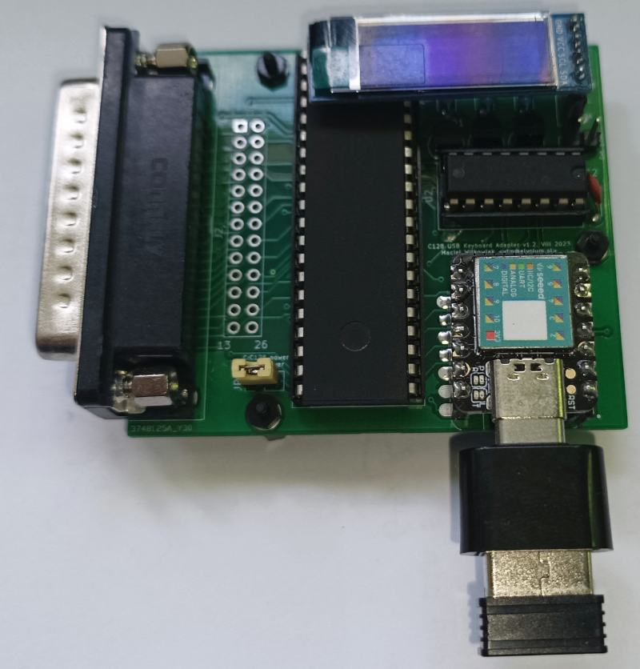
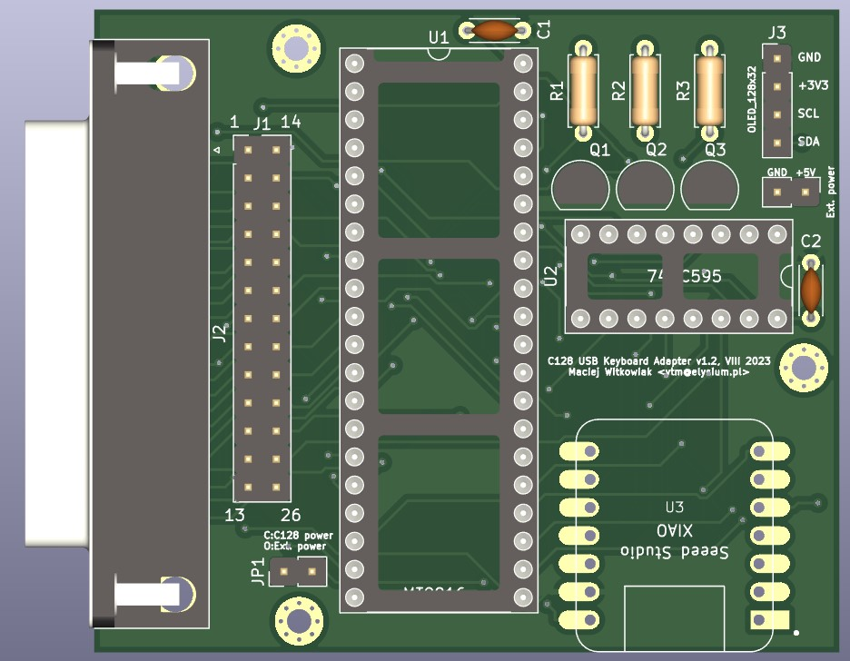
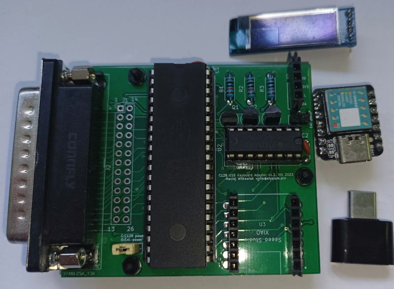
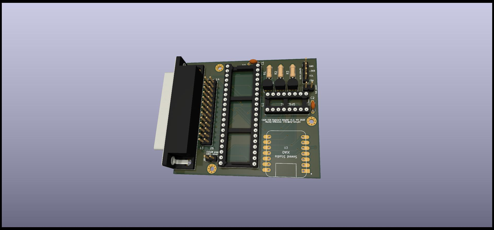
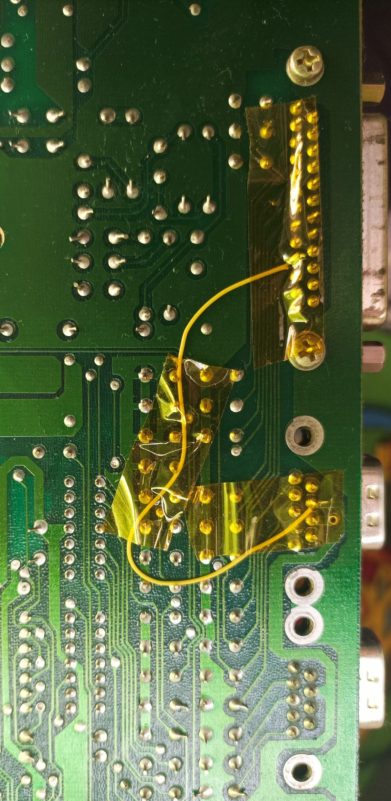
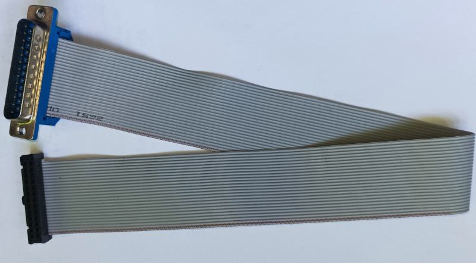

# C128 USB Keyboard

This project is designed to allow a modern USB keyboard to be used with a Commodore 128D/DCR in place of the original Commodore keyboard.

This project was originally forked from [Hartland/C64-Keyboard](https://github.com/Hartland/C64-Keyboard).
I made extensive hardware and software changes to support the full C128 keyboard.

I kept only the USB interface, as PS/2 keyboards are becoming retro themselves.

This project requires a Seeed Studio XIAO SAMD21, which has a USB-C socket. USB-C keyboards are still uncommon. I use a USB-C male to USB-A female OTG adapter to connect a standard PC keyboard.



-- Maciej 'YTM/Elysium' Witkowiak

<a href="https://www.pcbway.com/project/shareproject/C128_USB_Keyboard_adapter_dcf19251.html"></a>

# Features

- Works with any USB keyboard, including wireless models.
- Maps all C128 keys, including `40/80`, `CAPS` and the second set of cursor keys.
- Provides four keyboard layouts that can be switched on the fly.
- Supports a VICE-style joystick mode on the keypad, selected with NumLock or Shift+NumLock (may not work with some games).
- Supports an external power supply for an unmodified C128DCR.
- Supports an OLED display.
- Can be plugged directly into the keyboard port or mounted internally.

# PCB and schematic

Use KiCad to open the project in the [kicad-c128keyb](kicad-c128keyb/) folder.

The [kicad-c128keyb/plots](kicad-c128keyb/plots) folder contains Gerber files ready for manufacturing
and a [PDF schematic](kicad-c128keyb/plots/kicad-c128keyb.pdf).

To order PCBs, open the [shared project on PCBWay](https://www.pcbway.com/project/shareproject/C128_USB_Keyboard_adapter_dcf19251.html) and add the boards to your cart.

## Parts



* Seeed Studio XIAO SAMD21 (SAMD21, not RP2040)
* U1: MT8816 or MT8812
* U2: 74HCT595
* R1, R2, R3: 10 kΩ resistors
* Q1, Q2, Q3: 2N3904 transistors (or another NPN type, such as S9013)
* C1, C2: 100 nF capacitors
* PCB-mount male DB25 connector (option 1)
* 26-pin ribbon cable connector / 2 × 13-pin headers (option 2)
* Pin headers and sockets
* 128 × 32 SSD1306 I²C OLED display (optional)



## Features



- Plugs directly into the keyboard port when fitted with a male DB25 connector.
- Can use a ribbon cable for either an internal or external connection.
- Can be powered from the keyboard port or an external source, selected by a jumper.
- Can be fitted with a 128 × 32 I²C OLED display for status and debugging.

### Power (C128DCR only)

The C128D supplies +5 V on pin 4 of the keyboard port; the C128DCR does not.
An internal modification can add this connection to the C128DCR.

The photo below shows a wire on the underside of the C128DCR mainboard connecting +5 V from the joystick port to pin 4 of the keyboard port.



If you prefer not to open your C128DCR, you can supply external power from the nearby cassette or joystick port.
In this case, leave jumper JP1 open and connect +5 V to the `Ext. power` connector. Observe the polarity.

Options:

- JP1 open: supply power through `Ext. power` for an unmodified C128DCR.
- JP1 closed: leave `Ext. power` disconnected; use this setting for a C128D or a modified C128DCR.

### Flat cable: 26 pins (socket) to 25 pins (DB25 male)

If you prefer not to have the adapter protruding from the computer, you can make an extension cable.

You need:

* A 26-wire ribbon cable
* 26-pin ribbon cable connectors (a male PCB connector and a female cable connector)
* A male DE25 insulation-displacement connector for ribbon cable



Steps:

1. Solder the 26-pin male ribbon cable connector to J1.
2. Crimp the 26-pin female connector onto the cable, aligning the red wire (wire 1) with the triangular pin-1 mark.
3. Separate wire 26 (at the opposite edge from the red wire) from the ribbon and cut it as close to the female connector as possible.
4. Align the cable with the DE25 connector and crimp it, checking that the red wire connects to pin 1.

# Firmware

Use the Arduino IDE to compile and upload the sketch from [SEEED/C128_keyboard/C128_keyboard.ino](SEEED/C128_keyboard/C128_keyboard.ino).

The OLED shows the firmware release date below startup USB status messages,
for example `USB Configuring` / `FW 2026-10-30`. Set the release date in
[firmware_version.h](SEEED/C128_keyboard/firmware_version.h) when preparing a
new firmware release; recompiling the same source does not change its version.

* The XIAO uses the modified [USB host library](SEEED/C64_USB_Host_Library_SAMD). Install the matching [ZIP](SEEED/C64_USB_Host_Library_SAMD.zip) using Arduino IDE's **Sketch > Include Library > Add .ZIP Library**, or replace the installed library with this directory. Updating the sketch also requires updating this library on the computer used for compilation. The sketch rejects older library headers at compile time.
* If Arduino reports multiple libraries for `KeyboardController.h`, check the selected library path in the compilation log and remove or replace the outdated copy. Right Shift must arrive as HID usage `0xE5` with modifier mask `0x20`; use `getOemKey()` for HID usages, while `getKey()` returns ASCII.

* Install the XIAO board package in the Arduino IDE, following the manufacturer's instructions.

To force compilation with the USB library from this checkout, run Arduino CLI
from the repository root:

```sh
arduino-cli compile \
  --fqbn Seeeduino:samd:seeed_XIAO_m0 \
  --library "$PWD/SEEED/C64_USB_Host_Library_SAMD" \
  SEEED/C128_keyboard
```

The explicit [`--library` option](https://arduino.github.io/arduino-cli/1.5/sketch-build-process/#dependency-resolution)
has priority over libraries installed in the sketchbook. No ZIP installation is
needed for this build. The Seeed SAMD board package and the other dependencies
(U8g2 and ShiftRegister74HC595) must still be installed for Arduino CLI.

When using the Arduino IDE GUI, an alternative is to replace the installed
`C64_USB_Host_Library_SAMD` directory with a symbolic link to this checkout's
`SEEED/C64_USB_Host_Library_SAMD`. Move the old copy outside the sketchbook's
`libraries` directory, restart the IDE, and verify the selected library path
in verbose compilation output. Pulling changes into the checkout then also
updates the library used by the IDE.

# Keyboard mapping

Key maps are defined in [SEEED/C128_keyboard/keymaps.h](SEEED/C128_keyboard/keymaps.h). You can modify existing ones or add your own.

After defining a new keymap, add it to the `keymaps[]` array at the bottom of the file. The first entry is the default layout.

## C128 positional (default)

The top row follows the C128 keyboard layout. This layout is useful if you are familiar with the original keyboard.

| USB key | C128 key |
|---------|----------|
| ESC | RUN/STOP |
| F1 | ESC |
| F2 | TAB |
| F3 | ALT |
| F4 | CAPS/DIN (toggle) |
| F5 | HELP |
| F6 | LINEFEED |
| F7 | 40/80 (toggle) |
| F8 | NO SCROLL |
| F9 | F1/F2 |
| F10 | F3/F4 |
| F11 | F5/F6 |
| F12 | F7/F8 |
| Print Screen | reset MT8816 switchboard |
| Scroll Lock | Shift Lock |
| Pause | switch to next keymap |
| Insert | POUND |
| Home | CLR/HOME |
| Page Up | RESTORE |
| End | RUN/STOP |
| NumLock | enable/disable joystick #2 on keypad |
| Shift+NumLock | enable/disable joystick #1 on keypad |
| (keypad) | C128 keypad |
| left CTRL | C= key |
| left SHIFT | left SHIFT |
| left ALT | C128 top cursor down |
| left Win | C128 top cursor up |
| right CTRL | C128 top cursor right |
| right SHIFT | right SHIFT |
| AltGr | RESTORE |

## C128 symbolic

Symbols follow standard PC keycaps; for example, Shift+2 produces `@` rather than `"`.

Other changes:

- C128 top cursor keys are available via Shift+arrow keys.
- Both Ctrl keys map to CTRL.
- Both Windows keys map to the C= key.
- Left Alt maps to C128 ALT.
- AltGr maps to RESTORE.

## C64 positional

The same as C128 positional, except that the keypad digits map to the 1–0 keys above the QWERTY row.

## C64 symbolic

The same as C128 symbolic, except that the keypad digits map to the 1–0 keys above the QWERTY row.

# Joystick mode

Press NumLock (with or without Shift) to toggle joystick mode. When the NumLock LED is on, joystick mode is enabled.

The keypad directions are the same for both joystick ports:

| Keypad key | Direction |
| --- | --- |
| 7 | up + left |
| 8 | up |
| 9 | up + right |
| 4 | left |
| 6 | right |
| 1 | down + left |
| 2 | down |
| 3 | down + right |
| 5, 0, right Ctrl | FIRE |

A diagonal key is equivalent to holding its two direction keys together.
A direction remains active while any held key still requires it. For example,
releasing keypad 1 while holding keypad 4 leaves LEFT active.

This mode is not intended to replace a physical joystick: some games may interpret joystick #2 inputs as keypresses.
